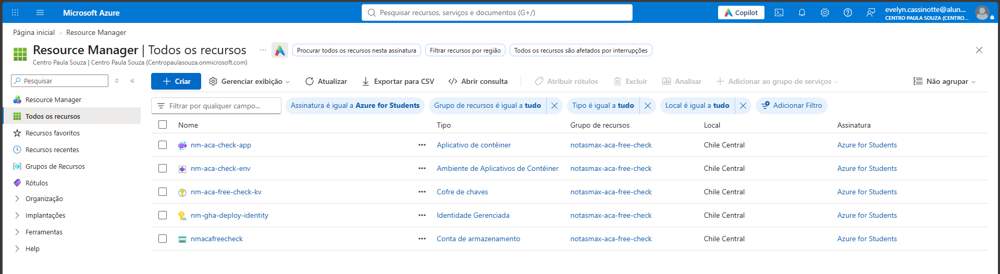

# Arquitetura de nuvem — NotasMAX

Este documento descreve a arquitetura alvo da aplicação em desenvolvimento. O frontend web e a API são publicados juntos em um Azure Container App, para manter a solução dentro dos recursos disponíveis na assinatura de estudante e reduzir componentes separados.

O ambiente utiliza serviços gratuitos ou consumo que pode ser coberto pelo Azure for Students e pelos limites incluídos no GitHub. Gratuidade, disponibilidade regional, cotas e crédito dependem da assinatura e do uso.

## Arquitetura alvo de desenvolvimento

Fonte editável: [diagrama-arquitetura-atlas-free.mmd](diagrama-arquitetura-atlas-free.mmd).

### Recursos configurados

#### MongoDB Atlas

#### Azure

| Camada | Serviço e configuração atual | Custo de referência |
|---|---|---|
| Aplicação web e API | Um Azure Container App em ambiente Workload profiles, perfil Consumption, região Chile Central, ingress HTTPS público na porta 5000, 0,25 vCPU, 0,5 GiB e escala de zero a uma réplica. O mesmo container serve o frontend React/Vite e a API Node.js/Express. | US$ 0 enquanto o consumo permanecer nas franquias mensais do perfil Consumption; excedentes são cobrados conforme uso e região. |
| Publicação da imagem | GitHub Actions publica uma imagem combinada no GHCR privado e atualiza o Container App por OIDC. | O armazenamento e a transferência de imagens de Container Registry estão atualmente gratuitos no GHCR. Minutos de Actions e armazenamento de artefatos seguem as cotas do plano GitHub. |
| Banco de dados | MongoDB Atlas Free M0, cluster na AWS em São Paulo, com usuário da aplicação restrito ao banco `NotasMax`. | US$ 0 dentro dos limites do M0. |
| Arquivos | Azure Storage Account `Standard_LRS`, camada Hot, região Chile Central; container `files` privado. O acesso da API usa identidade gerenciada e RBAC no escopo do container. | Variável conforme capacidade, operações e tráfego. A integração de arquivos ainda não é utilizada pelo fluxo atual da aplicação. |
| Segredos | Azure Key Vault Standard, região Chile Central. A identidade gerenciada do Container App tem acesso de leitura aos segredos necessários. | Variável conforme as operações. |

### Comunicação e rede

O navegador abre a aplicação por HTTPS no endereço público do Container App. Frontend e API compartilham a mesma origem: a interface é servida na raiz e chama a API em `/NotasMax`. O app mobile chama o mesmo endpoint HTTPS e envia o JWT no cabeçalho `Authorization: Bearer`.

O Container App usa o perfil Consumption, sem VNet própria e sem NAT Gateway. Portanto, sua saída não usa um IPv4 fixo. A lista de acesso de rede do Atlas está configurada como `0.0.0.0/0`: o endpoint aceita conexões de qualquer endereço IPv4, mas a autenticação ainda exige o usuário e a senha do banco. As conexões usam TLS. Essa configuração simplifica o ambiente de teste, mas amplia a exposição de rede. Use somente dados sintéticos, mantenha senha forte e exclusiva e não coloque credenciais no frontend, no app mobile ou no repositório.

O endpoint do Blob Storage também é público; isso permite conectividade sem VNet própria. O container `files` continua privado, o acesso anônimo está desabilitado, chaves compartilhadas estão desabilitadas e a API recebe `Storage Blob Data Contributor` somente no escopo do container. O navegador e o app mobile não acessam o Blob diretamente. Um endpoint público não concede autorização para ler ou gravar dados.

### Aplicação, autenticação e segredos

- A aplicação web e a API são entregues pela mesma imagem e pelo mesmo Container App.
- O site usa sessão por cookie `HttpOnly`, `Secure` e `SameSite=Lax`; a API aceita também JWT Bearer para os clientes mobile.
- `MONGODB-URI`, `JWT-SECRET` e a credencial de leitura do GHCR ficam no Key Vault e não devem ser incluídos no código-fonte ou em configurações públicas.
- A identidade gerenciada atribuída pelo sistema ao Container App acessa os segredos do Key Vault e o container privado de arquivos por RBAC.
- O GitHub Actions autentica no Azure por OIDC usando identidade de publicação separada, com permissão limitada à atualização do Container App.
- O acesso ao Atlas é feito com um usuário de banco separado da conta usada para entrar no painel Atlas. A política de rede `/0` não substitui a autenticação do banco.

### Limitações da assinatura de estudante

A assinatura aplica uma política de regiões e cotas próprias. A lista de regiões disponíveis pode variar por assinatura, e a presença de um serviço no catálogo não garante que ele possa ser provisionado naquela assinatura. Os recursos atualmente utilizados — ambiente e Container App, Storage Account e Key Vault — foram criados em Chile Central.

O tamanho atual de 0,25 vCPU e 0,5 GiB, com no máximo uma réplica, atende ao objetivo de demonstração e testes com baixo tráfego. O limite pode afetar a capacidade sob acessos simultâneos; a escala a zero também pode causar demora na primeira resposta após um período sem requisições. A política de regiões, as cotas de serviço e os limites do Atlas Free permanecem fora do controle da aplicação e podem mudar.

O crédito exibido no portal não elimina as políticas de região e de quota. Antes de aumentar o uso, confira no portal a oferta da assinatura, o saldo disponível e o custo estimado. Não conte com crédito como garantia de que um recurso está liberado ou de que permanecerá gratuito.

### Estimativa semanal de custo

| Componente | Estimativa semanal | Condição ou fator de cobrança |
|---|---:|---|
| Azure Container Apps Consumption | US$ 0 enquanto dentro das franquias aplicáveis | Cada assinatura recebe por mês 180.000 vCPU-segundos, 360.000 GiB-segundos e 2 milhões de solicitações HTTP externas sem custo. Com 0,25 vCPU e 0,5 GiB, as franquias de CPU e memória equivalem, cada uma, a aproximadamente 200 horas de uma réplica ativa por mês (cerca de 46 horas por semana), se não forem consumidas por outras aplicações da assinatura. Quando a aplicação está em zero réplicas, não há cobrança de computação. O excedente é cobrado por consumo. |
| MongoDB Atlas Free M0 | US$ 0 | Dentro dos limites do plano Free. O M0 tem limites próprios de capacidade, disponibilidade de regiões e recursos de rede. |
| GHCR | US$ 0 atualmente para armazenamento e transferência de imagens de Container Registry | A política atual do GitHub informa que armazenamento e transferência do Container Registry são gratuitos. Uso do GitHub Actions e artefatos continua sujeito às cotas do plano. |
| Azure Blob Storage | Variável; total semanal não calculado | Cobrança depende de GB armazenados por mês, operações, transferência, redundância e região. A aplicação ainda não usa o container em um fluxo de arquivos. |
| Azure Key Vault | Variável; total semanal não calculado | Cobrança depende do número e tipo de operações. |
| Transferência de dados | Variável; total semanal não calculado | Pode depender do volume servido aos navegadores e clientes mobile e da comunicação entre Azure Chile Central e Atlas na AWS São Paulo. |

**Estimativa-base:** US$ 0 por semana nas camadas com franquia ou plano gratuito, desde que os limites não sejam excedidos. O custo total não pode ser fechado sem medir armazenamento, operações do Key Vault, transferência e consumo compartilhado da assinatura. A conta de estudante pode cobrir cobranças elegíveis enquanto houver crédito aplicável, mas isso não altera as restrições de serviço e região. Esta arquitetura não inclui VNet nem NAT Gateway; portanto, não há custo semanal de NAT/IP reservado no desenho atual.

## Referências oficiais

### Microsoft Azure

- [Azure for Students — condições do benefício](https://learn.microsoft.com/en-us/azure/education-hub/about-azure-for-students)
- [Azure for Students — perguntas frequentes](https://learn.microsoft.com/en-us/azure/education-hub/faq)
- [Regiões permitidas em assinaturas Azure for Students](https://learn.microsoft.com/en-us/answers/questions/5994269/student-subscription-restriction)
- [Políticas e cotas de assinatura Azure](https://learn.microsoft.com/en-us/azure/azure-resource-manager/management/azure-subscription-service-limits)
- [Cobrança do Azure Container Apps](https://learn.microsoft.com/en-us/azure/container-apps/billing)
- [Escalonamento e réplicas no Azure Container Apps](https://learn.microsoft.com/en-us/azure/container-apps/scale-app)
- [Identidade e segurança no Azure Container Apps](https://learn.microsoft.com/en-us/azure/container-apps/security)
- [Segredos do Key Vault no Container Apps](https://learn.microsoft.com/en-us/azure/container-apps/manage-secrets)
- [Preços do Azure Container Apps](https://azure.microsoft.com/en-us/pricing/details/container-apps/)
- [Preços do Azure Blob Storage](https://azure.microsoft.com/en-us/pricing/details/storage/blobs/)
- [Planejar e estimar custos do Blob Storage](https://learn.microsoft.com/en-us/azure/storage/blobs/blob-storage-estimate-costs)
- [Autorização Blob com Microsoft Entra ID e RBAC](https://learn.microsoft.com/en-us/azure/storage/blobs/authorize-access-azure-active-directory)
- [Preços do Azure Key Vault](https://azure.microsoft.com/en-us/pricing/details/key-vault/)

### MongoDB

- [Limitações do Atlas Free](https://www.mongodb.com/docs/atlas/reference/free-shared-limitations/)
- [Lista de acesso IP do Atlas](https://www.mongodb.com/docs/atlas/security/ip-access-list/)
- [Segurança de rede do Atlas](https://www.mongodb.com/docs/atlas/architecture/current/network-security/)

### GitHub

- [GitHub Container Registry](https://docs.github.com/en/packages/working-with-a-github-packages-registry/working-with-the-container-registry)
- [Cobrança e uso de GitHub Packages](https://docs.github.com/en/billing/concepts/product-billing/github-packages)
- [Uso incluído nos planos GitHub](https://docs.github.com/en/billing/reference/product-usage-included)
- [Publicar imagens GHCR privadas no Azure Container Apps](https://learn.microsoft.com/en-us/azure/container-apps/github-actions)
- [OpenID Connect no Azure a partir do GitHub Actions](https://docs.github.com/en/actions/how-tos/secure-your-work/security-harden-deployments/oidc-in-azure)
