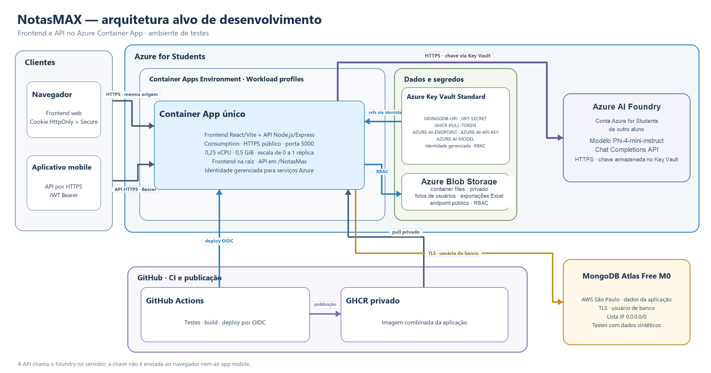
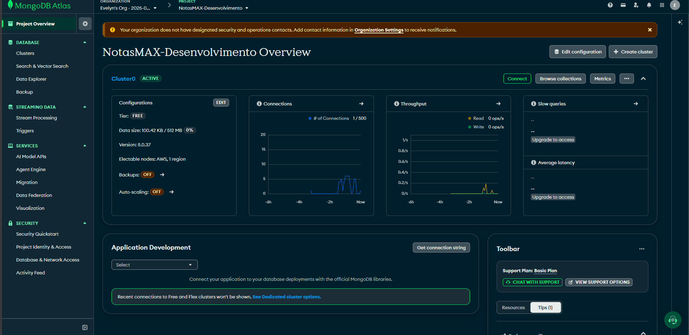
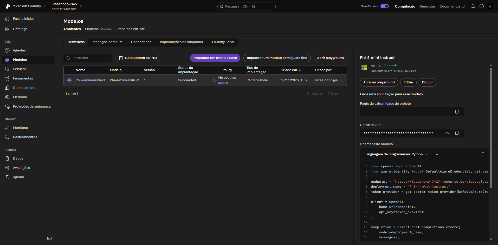
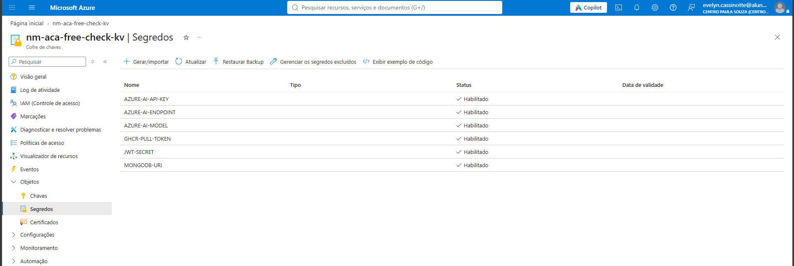
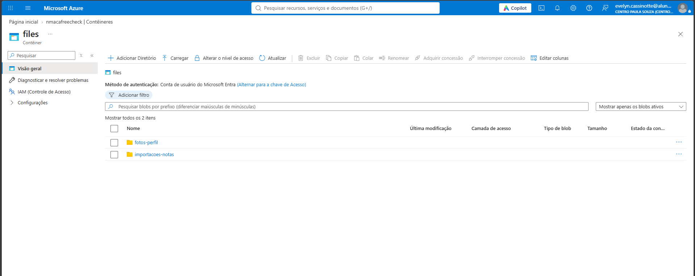

# Arquitetura de nuvem — NotasMAX

Este documento descreve a arquitetura da aplicação. O frontend web e a API são publicados juntos em um Azure Container App, para manter a solução dentro dos recursos disponíveis na assinatura de estudante e reduzir componentes separados.

O projeto prioriza a utilização de serviços gratuitos ou de baixo consumo consumo que pode ser coberto pelo Azure for Students e pelos limites incluídos no GitHub.

## Arquitetura alvo de desenvolvimento

Fonte editável: [diagrama-arquitetura-atlas-free.mmd](diagrama-arquitetura-atlas-free.mmd).

### Recursos configurados

#### MongoDB Atlas

#### Azure

#### Evidências do Foundry, Key Vault e Storage

As capturas abaixo registram a implantação do modelo, os nomes dos segredos habilitados no Key Vault e as pastas visíveis no container `files`. Os valores dos segredos não são exibidos.

| Camada | Serviço e configuração atual | Custo de referência |
|---|---|---|
| Aplicação web e API | Um Azure Container App em ambiente Workload profiles, perfil Consumption, região Chile Central, ingress HTTPS público na porta 5000, 0,25 vCPU, 0,5 GiB e escala de zero a uma réplica. O mesmo container serve o frontend React/Vite e a API Node.js/Express. | US$ 0 enquanto o consumo permanecer nas franquias mensais do perfil Consumption; excedentes são cobrados conforme uso e região. |
| Publicação da imagem | GitHub Actions publica uma imagem combinada no GHCR privado e atualiza o Container App por OIDC. | O armazenamento e a transferência de imagens de Container Registry estão atualmente gratuitos no GHCR. Minutos de Actions e armazenamento de artefatos seguem as cotas do plano GitHub. |
| Banco de dados | MongoDB Atlas Free M0, cluster na AWS em São Paulo, com usuário da aplicação restrito ao banco `NotasMax`. | US$ 0 dentro dos limites do M0. |
| Arquivos | Azure Storage Account `Standard_LRS`, camada Hot, região Chile Central; container `files` privado. Armazena fotos dos usuários e arquivos de exportação Excel; as pastas observadas incluem `fotos-perfil` e `importacoes-notas`. O acesso da API usa identidade gerenciada e RBAC no escopo do container. | Variável conforme capacidade, operações e tráfego. |
| Segredos | Azure Key Vault Standard, região Chile Central. A identidade gerenciada do Container App tem acesso de leitura aos segredos necessários. | Variável conforme as operações. |
| IA generativa | Azure AI Foundry, modelo `Phi-4-mini-instruct`, em uma conta Azure for Students de outro aluno. A API chama o modelo no servidor; endpoint, chave e nome do modelo ficam no Key Vault da conta do projeto. | Depende do modelo, da modalidade de implantação e do uso de tokens; não está incluído na estimativa-base. |

### Por que Chile Central

Escolhemos o Chile Central pois foi a região mais próxima do banco disponivel na conta de estudante. O Azure também listava Brazil South, em São Paulo, mas o mesmo não estava disponivel para a assinatura no momento da criação dos recursos.

O Atlas M0 usado pelo projeto está na AWS em São Paulo (`sa-east-1`). Assim, as chamadas da API até o banco cruzam regiões e provedores de nuvem pela rede pública, protegidas por TLS. Essa distância acaba podendo acrescentar latência e custos variáveis de transferência.

Porém a escolha atual priorizou utilizar os recursos de baixo custos ou gratuitos.

### Como os recursos se comunicam

#### Publicação da aplicação

1. O GitHub Actions executa as verificações do repositório, monta uma imagem que contém o frontend e a API e publica essa imagem privada no GHCR.
2. Para atualizar o Azure, o workflow usa OIDC e uma identidade de publicação separada. A atribuição RBAC dessa identidade limita a ação ao Container App configurado.
3. O Container Apps busca a imagem privada no GHCR usando a credencial de pull guardada no Key Vault. Depois de atualizar a imagem, o serviço cria uma revisão da aplicação.

#### Acesso pelo navegador e pelo mobile

O navegador abre a aplicação por HTTPS no endereço público do Container App. O container serve a interface web na raiz e a API no caminho `/NotasMax`, sob o mesmo host. O frontend chama esse caminho; por compartilharem a origem, as chamadas web não precisam atravessar um domínio de API separado.

O app mobile chama o mesmo endpoint HTTPS. Tanto as requisições web quanto as mobile chegam ao Container App; o cliente não se conecta diretamente ao MongoDB Atlas nem ao Blob Storage.

#### Acesso da API aos dados e segredos

O Container App usa uma identidade gerenciada atribuída pelo sistema para acessar serviços Azure. O Azure emite tokens para essa identidade sem exigir uma senha ou chave fixa no código. A identidade tem a função `Key Vault Secrets User` no Key Vault para ler os segredos referenciados pela aplicação, e `Storage Blob Data Contributor` somente no container `files`. Ao iniciar ou atualizar a aplicação, o Container Apps usa essa identidade para resolver as referências do Key Vault e disponibilizar os segredos ao container.

Com a URI obtida por meio do segredo `MONGODB-URI`, a API conecta-se ao endpoint público do Atlas usando o usuário de banco e TLS. A lista de acesso Atlas está configurada como `0.0.0.0/0`, então qualquer endereço IPv4 pode tentar chegar ao endpoint; a autenticação do banco ainda exige credenciais válidas. Isso foi necessario pois Container App não tem VNet própria nem NAT Gateway e, portanto, não possui um IP de saída fixo.

O endpoint do Blob Storage é público para permitir conectividade sem VNet própria, mas o container `files` é privado e não permite leitura anônima. A identidade do Container App precisa ser autorizada pelo RBAC para acessar os blobs. O container mantém fotos dos usuários e arquivos de exportação Excel; o portal mostra as pastas `fotos-perfil` e `importacoes-notas`. O navegador e o app mobile não acessam o Blob diretamente.

#### Inferência com Azure AI Foundry

Na arquitetura alvo, somente a API no Container App chama o endpoint HTTPS de chat completions do Azure AI Foundry, usando o modelo `Phi-4-mini-instruct`. O recurso Foundry está em uma conta Azure for Students de outro aluno, separada da conta que contém o Container App. Por isso, a API acessa o endpoint com uma chave de API guardada como segredo no Key Vault do projeto; não há identidade gerenciada compartilhada entre as duas contas. A chamada é feita no servidor com a chave no cabeçalho `api-key`; o navegador e o app mobile chamam apenas a API NotasMAX e nunca recebem a chave.

O Container App usa sua identidade gerenciada atribuída pelo sistema e referências do Key Vault para disponibilizar a configuração ao processo da API:

| Segredo no Key Vault | Variável de ambiente da API |
|---|---|
| `AZURE-AI-ENDPOINT` | `AZURE_AI_ENDPOINT` |
| `AZURE-AI-API-KEY` | `AZURE_AI_API_KEY` |
| `AZURE-AI-MODEL` | `AZURE_AI_MODEL` |

A API envia o conteúdo da solicitação diretamente ao serviço Foundry por HTTPS. A chave permanece no backend e não deve ser incluída no bundle do frontend, no app mobile, no repositório ou nos logs. O modelo e o endpoint são valores de configuração mantidos no Key Vault junto da chave.

### Aplicação, autenticação e segredos

- A aplicação web e a API são entregues pela mesma imagem e pelo mesmo Container App.
- O site usa sessão por cookie `HttpOnly`, `Secure` e `SameSite=Lax`; a API aceita também JWT Bearer para os clientes mobile.
- `MONGODB-URI`, `JWT-SECRET`, a credencial de leitura do GHCR e os valores `AZURE-AI-ENDPOINT`, `AZURE-AI-API-KEY` e `AZURE-AI-MODEL` ficam no Key Vault; seus valores não são incluídos no código-fonte ou em configurações públicas.
- A identidade gerenciada do Container App lê os segredos do Key Vault por RBAC; referências da Container App os mapeiam para variáveis de ambiente somente no container da API.
- O GitHub Actions autentica no Azure por OIDC usando identidade de publicação separada, com permissão limitada à atualização do Container App. Essa identidade de publicação não é a identidade usada pela aplicação durante a execução.
- O acesso ao Atlas é feito com um usuário de banco separado da conta usada para entrar no painel Atlas. A política de rede `/0` não substituiu a autenticação do banco.

#### RBAC em termos simples

Uma atribuição RBAC combina três partes: **identidade** (quem acessa), **função** (quais operações pode fazer) e **escopo** (em quais recursos a função vale). Restringir o escopo reduz o alcance de uma permissão se uma identidade for usada indevidamente.

Neste ambiente, a identidade gerenciada do Container App pode ler segredos no Key Vault por meio de `Key Vault Secrets User`. Isso inclui a chave usada pela API para chamar o Foundry; o serviço Foundry não recebe acesso ao Key Vault. No Storage, `Storage Blob Data Contributor` vale apenas para o container `files`, não para toda a assinatura nem para outros containers. A identidade de publicação do GitHub é diferente: o OIDC autentica o workflow no Azure, e a função atribuída permite atualizar o Container App. Esses acessos do Azure são independentes do controle do MongoDB Atlas, que continua usando seu usuário de banco e a própria lista de acesso de rede.

### Limitações da assinatura de estudante

A assinatura aplica uma política de regiões e cotas próprias. A lista de regiões disponíveis acaba variando por assinatura, e a presença de um serviço no catálogo não garante que ele possa ser provisionado naquela assinatura. Os recursos atualmente utilizados — ambiente e Container App, Storage Account e Key Vault — foram criados em Chile Central por esse motivo.

O tamanho atual de 0,25 vCPU e 0,5 GiB, com no máximo uma réplica, atende ao objetivo de demonstração e testes com baixo tráfego. O limite pode afetar a capacidade sob acessos simultâneos; a escala a zero também pode causar demora na primeira resposta após um período sem requisições. A política de regiões, as cotas de serviço e os limites do Atlas Free permanecem fora do controle da aplicação e podem mudar.

### Estimativa semanal de custo

| Componente | Estimativa semanal | Condição ou fator de cobrança |
|---|---:|---|
| Azure Container Apps Consumption | US$ 0 enquanto dentro das franquias aplicáveis | Cada assinatura recebe por mês 180.000 vCPU-segundos, 360.000 GiB-segundos e 2 milhões de solicitações HTTP externas sem custo. Com 0,25 vCPU e 0,5 GiB, as franquias de CPU e memória equivalem, cada uma, a aproximadamente 200 horas de uma réplica ativa por mês (cerca de 46 horas por semana), se não forem consumidas por outras aplicações da assinatura. Quando a aplicação está em zero réplicas, não há cobrança de computação. O excedente é cobrado por consumo. |
| MongoDB Atlas Free M0 | US$ 0 | Dentro dos limites do plano Free. O M0 tem limites próprios de capacidade, disponibilidade de regiões e recursos de rede. |
| GHCR | US$ 0 atualmente para armazenamento e transferência de imagens de Container Registry | A política atual do GitHub informa que armazenamento e transferência do Container Registry são gratuitos. Uso do GitHub Actions e artefatos continua sujeito às cotas do plano. |
| Azure AI Foundry | Variável | A cobrança varia conforme o consumo do  modelo |
| Azure Blob Storage | Variável | Cobrança depende de GB armazenados por mês, operações, transferência, redundância e região. O container `files` mantém fotos dos usuários e arquivos Excel de exportação. |
| Azure Key Vault | Variável | Cobrança depende do número e tipo de operações. |
| Transferência de dados | Variável | Pode depender do volume servido aos navegadores e clientes mobile e da comunicação entre Azure Chile Central e Atlas na AWS São Paulo. |

**Estimativa-base da infraestrutura sem inferência de IA:** US$ 0 por semana nas camadas com franquia ou plano gratuito, desde que os limites não sejam excedidos. As chamadas ao Foundry não estão incluídas: o custo pode variar com o modelo, a implantação e os tokens de entrada e saída. O custo total também depende de armazenamento, operações do Key Vault, transferência e consumo compartilhado da assinatura. A conta de estudante pode cobrir cobranças elegíveis enquanto houver crédito aplicável, mas isso não altera as restrições de serviço e região.

## Referências oficiais

### Microsoft Azure

- [Azure for Students — condições do benefício](https://learn.microsoft.com/en-us/azure/education-hub/about-azure-for-students)
- [Azure for Students — perguntas frequentes](https://learn.microsoft.com/en-us/azure/education-hub/faq)
- [Regiões permitidas em assinaturas Azure for Students](https://learn.microsoft.com/en-us/answers/questions/5994269/student-subscription-restriction)
- [Políticas e cotas de assinatura Azure](https://learn.microsoft.com/en-us/azure/azure-resource-manager/management/azure-subscription-service-limits)
- [Lista de regiões Azure](https://learn.microsoft.com/en-us/azure/reliability/regions-list)
- [Cobrança do Azure Container Apps](https://learn.microsoft.com/en-us/azure/container-apps/billing)
- [Escalonamento e réplicas no Azure Container Apps](https://learn.microsoft.com/en-us/azure/container-apps/scale-app)
- [Identidade e segurança no Azure Container Apps](https://learn.microsoft.com/en-us/azure/container-apps/security)
- [Segredos do Key Vault no Container Apps](https://learn.microsoft.com/en-us/azure/container-apps/manage-secrets)
- [Variáveis de ambiente do Container Apps](https://learn.microsoft.com/en-us/azure/container-apps/environment-variables)
- [API de chat completions do Azure AI Foundry](https://learn.microsoft.com/en-us/azure/foundry/openai/latest)
- [Opções de implantação de modelos no Foundry](https://learn.microsoft.com/en-us/azure/foundry/concepts/deployments-overview)
- [Custos de modelos no Foundry](https://learn.microsoft.com/en-us/azure/foundry/concepts/manage-costs)
- [Visão geral do Azure RBAC](https://learn.microsoft.com/en-us/azure/role-based-access-control/overview)
- [Escopo das atribuições RBAC](https://learn.microsoft.com/en-us/azure/role-based-access-control/scope-overview)
- [Preços do Azure Container Apps](https://azure.microsoft.com/en-us/pricing/details/container-apps/)
- [Preços do Azure Blob Storage](https://azure.microsoft.com/en-us/pricing/details/storage/blobs/)
- [Planejar e estimar custos do Blob Storage](https://learn.microsoft.com/en-us/azure/storage/blobs/blob-storage-estimate-costs)
- [Autorização Blob com Microsoft Entra ID e RBAC](https://learn.microsoft.com/en-us/azure/storage/blobs/authorize-access-azure-active-directory)
- [Atribuir função de acesso a dados Blob no escopo do container](https://learn.microsoft.com/en-us/azure/storage/blobs/assign-azure-role-data-access)
- [Preços do Azure Key Vault](https://azure.microsoft.com/en-us/pricing/details/key-vault/)

### MongoDB

- [Limitações do Atlas Free](https://www.mongodb.com/docs/atlas/reference/free-shared-limitations/)
- [Regiões AWS disponíveis no Atlas](https://www.mongodb.com/docs/atlas/reference/amazon-aws/)
- [Lista de acesso IP do Atlas](https://www.mongodb.com/docs/atlas/security/ip-access-list/)
- [Segurança de rede do Atlas](https://www.mongodb.com/docs/atlas/architecture/current/network-security/)

### GitHub

- [GitHub Container Registry](https://docs.github.com/en/packages/working-with-a-github-packages-registry/working-with-the-container-registry)
- [Cobrança e uso de GitHub Packages](https://docs.github.com/en/billing/concepts/product-billing/github-packages)
- [Uso incluído nos planos GitHub](https://docs.github.com/en/billing/reference/product-usage-included)
- [Publicar imagens GHCR privadas no Azure Container Apps](https://learn.microsoft.com/en-us/azure/container-apps/github-actions)
- [OpenID Connect no Azure a partir do GitHub Actions](https://docs.github.com/en/actions/how-tos/secure-your-work/security-harden-deployments/oidc-in-azure)
