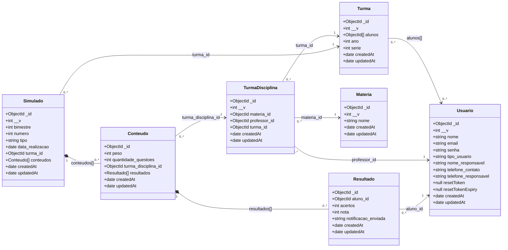

# NotasMAX — Diagrama de classes do modelo de persistência (MongoDB)

Fonte: exportação `NotasMax_05_11_2026.mdm` do MongoDB Compass, fornecida em 05/11/2026.

## Descrição do diagrama de classes

O diagrama de classes do **NotasMAX** representa os principais modelos de persistência do sistema, seus atributos e seus relacionamentos, com base na estrutura observada no MongoDB Compass. São sete classes: **`Usuario`**, **`Turma`**, **`Materia`**, **`TurmaDisciplina`**, **`Simulado`**, **`Conteudo`** e **`Resultado`**. `Usuario` reúne os perfis de alunos, professores e administradores; `Turma` e `Materia` organizam as informações acadêmicas; e `TurmaDisciplina` associa turma, professor e disciplina.

`Simulado` contém objetos `Conteudo`, que por sua vez contêm objetos `Resultado`, representando a composição de documentos incorporados no MongoDB. As demais associações são feitas por identificadores **`ObjectId`**. Assim, o diagrama facilita a compreensão dos modelos e de suas ligações, sem representar tabelas ou chaves estrangeiras de um banco relacional.

## Interpretação

- **Associação (`-->`)**: vínculo lógico por `ObjectId`, sem chave estrangeira imposta pelo MongoDB.
- **Composição (`*--`)**: subdocumentos incorporados; `Conteudo` pertence ao array `conteudos` de `Simulado`, e `Resultado` pertence ao array `resultados` de `Conteudo`.
- `Usuario` representa todos os tipos de usuário; `professor_id` e `aluno_id` referenciam usuários com papéis distintos, não coleções próprias.
- As multiplicidades das referências indicam a interpretação lógica esperada. O arquivo Compass marca os relacionamentos como **inferidos**, não como regras de integridade verificadas.
- Os tipos são os tipos BSON identificados no arquivo `.mdm`. `resetToken` e `resetTokenExpiry` apareceram como `null` nos dados inspecionados, o que **não comprova** que esses campos aceitem somente `null` no schema da aplicação.
- `__v` é um campo de versionamento usual do Mongoose. `createdAt` e `updatedAt` são campos de data observados nos documentos.

> Este é um diagrama de classes **dos dados persistidos**, não um diagrama de todas as classes, métodos, serviços e telas da aplicação. A estrutura foi extraída do modelo do Compass, não de uma validação dos schemas atuais do código-fonte.
