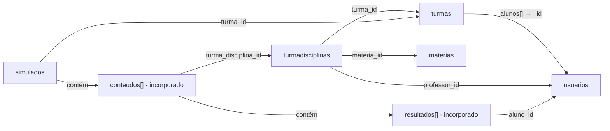
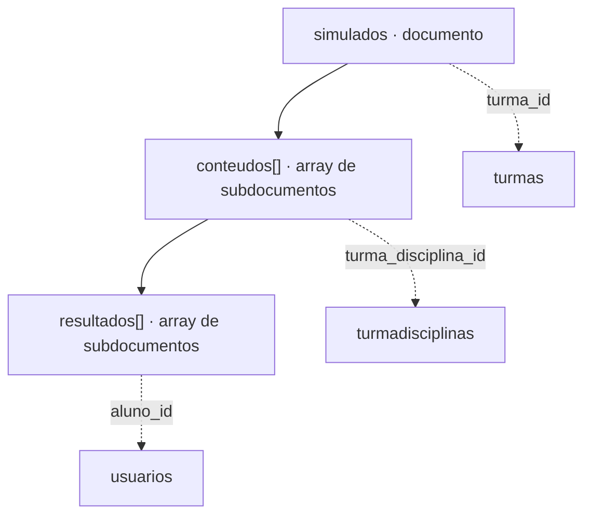

# Modelo de dados MongoDB — NotasMAX

> Fonte: exportação `NotasMax_05_11_2026.mdm` do MongoDB Compass (05/11/2026). Este documento descreve o modelo observado/exportado, não validações obrigatórias da aplicação.

## Visão geral

O banco `NotasMax` possui cinco coleções no modelo exportado: `usuarios`, `turmas`, `materias`, `turmadisciplinas` e `simulados`. Os arrays `conteudos` e `resultados` são documentos incorporados à coleção `simulados`, e não coleções independentes.

## Diagrama de coleções e referências

### Descrição do modelo de dados

O banco de dados do **NotasMAX** utiliza o MongoDB, um sistema NoSQL que organiza as informações em documentos agrupados em coleções. O modelo é composto por cinco coleções principais: **`usuarios`**, **`turmas`**, **`materias`**, **`turmadisciplinas`** e **`simulados`**. A coleção `usuarios` armazena alunos, professores e administradores; `turmas` organiza os grupos de alunos; `materias` registra as disciplinas; e `turmadisciplinas` associa turmas, professores e matérias.

A coleção `simulados` reúne as avaliações, com seus conteúdos e resultados armazenados como **subdocumentos incorporados**. As ligações entre coleções são realizadas por referências **`ObjectId`**, sem chaves estrangeiras relacionais. Essa combinação de referências e incorporação permite organizar as informações acadêmicas e os resultados das avaliações de maneira coerente com o modelo documental do MongoDB.

**Legenda:** setas com `*_id` ou `alunos[]` indicam referências lógicas por `ObjectId`; “contém” indica incorporação de subdocumentos. As ligações foram inferidas no Compass, não são chaves estrangeiras impostas pelo MongoDB.

## Estrutura documental dos simulados

## Dicionário de dados

Os tipos abaixo são os tipos BSON registrados no modelo exportado. A coluna **Presente no modelo** indica se o campo consta da lista `required` da exportação; isso **não comprova** que exista um validador `required` configurado no MongoDB ou no Mongoose.

### `materias`

| Campo | Tipo BSON | Presente no modelo | Observação |
|---|---|---|---|
| `_id` | `objectId` | Sim |  |
| `__v` | `int` | Sim |  |
| `createdAt` | `date` | Sim |  |
| `nome` | `string` | Sim |  |
| `updatedAt` | `date` | Sim |  |

### `simulados`

| Campo | Tipo BSON | Presente no modelo | Observação |
|---|---|---|---|
| `_id` | `objectId` | Sim |  |
| `__v` | `int` | Sim |  |
| `bimestre` | `int` | Sim |  |
| `conteudos` | `array<object>` | Sim | Subdocumentos incorporados |
| `conteudos[]._id` | `objectId` | Sim |  |
| `conteudos[].createdAt` | `date` | Sim |  |
| `conteudos[].peso` | `int` | Sim |  |
| `conteudos[].quantidade_questoes` | `int` | Sim |  |
| `conteudos[].resultados` | `array<object>` | Sim | Subdocumentos incorporados |
| `conteudos[].resultados[]._id` | `objectId` | Sim |  |
| `conteudos[].resultados[].acertos` | `int` | Sim |  |
| `conteudos[].resultados[].aluno_id` | `objectId` | Sim |  |
| `conteudos[].resultados[].createdAt` | `date` | Sim |  |
| `conteudos[].resultados[].nota` | `int` | Sim |  |
| `conteudos[].resultados[].notificacao_enviada` | `string` | Sim |  |
| `conteudos[].resultados[].updatedAt` | `date` | Sim |  |
| `conteudos[].turma_disciplina_id` | `objectId` | Sim |  |
| `conteudos[].updatedAt` | `date` | Sim |  |
| `createdAt` | `date` | Sim |  |
| `data_realizacao` | `date` | Sim |  |
| `numero` | `int` | Sim |  |
| `tipo` | `string` | Sim |  |
| `turma_id` | `objectId` | Sim |  |
| `updatedAt` | `date` | Sim |  |

### `turmadisciplinas`

| Campo | Tipo BSON | Presente no modelo | Observação |
|---|---|---|---|
| `_id` | `objectId` | Sim |  |
| `__v` | `int` | Sim |  |
| `createdAt` | `date` | Sim |  |
| `materia_id` | `objectId` | Sim |  |
| `professor_id` | `objectId` | Sim |  |
| `turma_id` | `objectId` | Sim |  |
| `updatedAt` | `date` | Sim |  |

### `turmas`

| Campo | Tipo BSON | Presente no modelo | Observação |
|---|---|---|---|
| `_id` | `objectId` | Sim |  |
| `__v` | `int` | Sim |  |
| `alunos` | `array<objectId>` | Sim | Referências ObjectId |
| `ano` | `int` | Sim |  |
| `createdAt` | `date` | Sim |  |
| `serie` | `int` | Sim |  |
| `updatedAt` | `date` | Sim |  |

### `usuarios`

| Campo | Tipo BSON | Presente no modelo | Observação |
|---|---|---|---|
| `_id` | `objectId` | Sim |  |
| `__v` | `int` | Sim |  |
| `createdAt` | `date` | Sim |  |
| `email` | `string` | Sim |  |
| `nome` | `string` | Sim |  |
| `nome_responsavel` | `string` | Não |  |
| `resetToken` | `null` | Sim |  |
| `resetTokenExpiry` | `null` | Sim |  |
| `senha` | `string` | Sim |  |
| `telefone_contato` | `string` | Sim |  |
| `telefone_responsavel` | `string` | Não |  |
| `tipo_usuario` | `string` | Sim |  |
| `updatedAt` | `date` | Sim |  |

## Referências identificadas

| Origem | Campo | Destino |
|---|---|---|
| `turmadisciplinas` | `materia_id` | `materias._id` |
| `simulados` | `conteudos[].turma_disciplina_id` | `turmadisciplinas._id` |
| `simulados` | `turma_id` | `turmas._id` |
| `turmadisciplinas` | `turma_id` | `turmas._id` |
| `simulados` | `conteudos[].resultados[].aluno_id` | `usuarios._id` |
| `turmadisciplinas` | `professor_id` | `usuarios._id` |
| `turmas` | `alunos` | `usuarios._id` |

## Observações sobre a modelagem

- Os campos `_id` identificam documentos e subdocumentos; `__v` é um campo de versionamento encontrado nos documentos.
- `createdAt` e `updatedAt` representam datas armazenadas no modelo.
- `resetToken` e `resetTokenExpiry` aparecem com tipo `null` na amostra exportada. Isso **não significa** que esses campos aceitem exclusivamente `null` na aplicação.
- O arquivo `.mdm` lista `indexes: []` nas cinco coleções; portanto, não é possível concluir por essa exportação quais índices realmente existem no banco, inclusive o índice padrão de `_id`.
- As relações do Compass estão marcadas como **inferidas**. Cardinalidades e integridade referencial precisam ser verificadas nos schemas da API e nas regras de negócio.
- O diagrama descreve o modelo físico/documental do MongoDB e complementa, mas não substitui, o diagrama de classes UML.

## Como usar na documentação

Salve este arquivo em `modelo-dados/modelo-dados-mongodb.md`. O GitHub renderiza automaticamente os blocos Mermaid.
